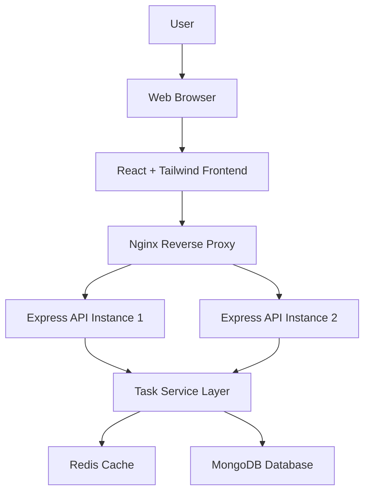

# System Architecture
 TODO: Prepare the complete System Architecture before implementation.
# TaskFlow — System Architecture Document

**Document:** System Architecture  
**Version:** 1.0  
**Status:** Proposed Architecture  
**Project:** TaskFlow — Smart Task Management System  
**Architecture Style:** Client–Server, Layered Backend, Service-Oriented Deployment  
**Frontend:** React, Tailwind CSS, Vite  
**Backend:** Node.js, Express.js  
**Database:** MongoDB, Mongoose  
**Cache:** Redis  
**Containerization:** Docker, Docker Compose  
**Reverse Proxy and Load Balancer:** Nginx  
**Continuous Integration:** GitHub Actions

---

## 1. Introduction

### 1.1 Purpose

This document defines the proposed technical architecture of TaskFlow. It describes the system components, their responsibilities, communication patterns, data flows, deployment topology, and architectural decisions.

The document provides a blueprint for implementation before application code is written.

### 1.2 Architectural Goals

The architecture aims to:

1. Separate the frontend from backend business logic.
2. Separate HTTP handling from business logic and database operations.
3. Use MongoDB for persistent data storage.
4. Introduce Redis for selected cacheable operations.
5. Support multiple backend instances behind Nginx.
6. Use Docker Compose for reproducible local environments.
7. Automate tests and build verification using GitHub Actions.
8. Support maintainability, testability, security, and future extension.
9. Avoid unnecessary complexity in the initial release.

### 1.3 Architectural Principles

**Separation of concerns:** Each component should have a clearly defined responsibility.

**Single source of truth:** MongoDB will be the persistent source of truth for task records.

**Stateless application instances:** Backend instances should not rely on local memory for persistent business data.

**Validation at the boundary:** Incoming data must be validated by the backend even when the frontend also validates it.

**Fail clearly:** Errors should be logged safely and returned through consistent API responses.

**Incremental implementation:** Build and verify the core application before introducing optional infrastructure.

**Measured optimization:** Redis and load balancing should be tested rather than assumed to improve performance.

---

## 2. High-Level System Architecture

The system will use a React frontend, an Express REST API, MongoDB persistence, and Redis caching. Nginx will act as the reverse proxy when the load-balancing configuration is enabled.

### 2.1 Logical Architecture Diagram



**Diagram interpretation:** The browser displays the frontend, which communicates with the backend API through Nginx. Nginx can distribute requests across backend instances. The backend uses shared services and accesses Redis and MongoDB as required.

The diagram represents the intended architecture. It does not indicate that these services have already been implemented or deployed.

### 2.2 Main Architectural Components

| Component | Responsibility |
|---|---|
| Web Browser | Runs the frontend application. |
| React Frontend | Displays task lists, forms, filters, and dashboard statistics. |
| Tailwind CSS | Provides responsive styling. |
| API Service | Centralizes frontend HTTP requests. |
| Nginx | Routes incoming HTTP requests and distributes them across backend instances. |
| Express Routes | Map HTTP endpoints to controllers. |
| Controllers | Process HTTP requests and construct responses. |
| Services | Implement task operations and coordinate cache behavior. |
| Mongoose Models | Define task structure and interact with MongoDB. |
| Redis | Stores selected temporary query results. |
| MongoDB | Stores persistent task records. |
| GitHub Actions | Runs automated tests and build checks. |
| Docker Compose | Defines and connects local application services. |

---

## 3. Frontend Architecture

### 3.1 Overview

The frontend will be a single-page application built using React, Vite, and Tailwind CSS.

Its primary responsibilities are to present task information, capture user input, communicate with the API, and display operation results.

Business rules and data validation must also be enforced by the backend; frontend validation is primarily for usability.

### 3.2 Frontend Components

**Pages**

- `Dashboard.jsx`: Displays task summaries and productivity statistics.
- `Tasks.jsx`: Displays and manages the task list.
- `NotFound.jsx`: Displays a message for unsupported application routes.

**Reusable Components**

- `Navbar.jsx`: Provides application navigation.
- `Sidebar.jsx`: Provides access to major sections when included in the layout.
- `TaskCard.jsx`: Displays an individual task.
- `TaskForm.jsx`: Provides task creation and editing controls.
- `TaskList.jsx`: Renders task collections.
- `FilterBar.jsx`: Provides search and filtering controls.
- `DashboardStats.jsx`: Displays task statistics.
- `Loading.jsx`: Displays loading feedback.
- `ErrorMessage.jsx`: Displays user-friendly errors.

**Supporting Modules**

- `services/api.js`: Configures API requests and common error handling.
- `hooks/useTasks.js`: Encapsulates reusable task-loading and mutation logic.
- `utils/taskUtils.js`: Contains reusable task-related utility functions.

These names form the proposed structure. Components should be added or adjusted according to the finalized UI requirements.

### 3.3 Frontend Request Flow

1. A user interacts with a page or component.
2. React validates basic form input.
3. The component or custom hook invokes the API service.
4. The API service sends an HTTP request.
5. The frontend handles the response and updates its state.
6. The interface displays the updated data or an appropriate error message.

### 3.4 Frontend State

The initial application can use React component state and custom hooks for task data, loading states, form state, and filters.

A separate global state library should only be introduced if the application's complexity justifies it.

Task data must be refreshed or updated after successful server-side mutations so that the interface does not display stale results.

---

## 4. Backend Architecture

### 4.1 Overview

The backend will use Node.js and Express.js to expose a REST API.

The backend will follow a layered architecture:

**Routes → Middleware → Controllers → Services → Models / External Services**

This arrangement separates HTTP handling from business logic and persistence.

### 4.2 Routes Layer

The routes layer defines HTTP methods and endpoint paths.

Proposed route modules:

- `taskRoutes.js`: Task retrieval, creation, updating, and deletion.
- `healthRoutes.js`: Health and readiness endpoints.

Routes may apply validation middleware before calling the relevant controller.

### 4.3 Middleware Layer

Middleware handles shared request processing.

Planned responsibilities include:

- Request validation.
- Centralized error handling.
- Request logging with appropriate privacy controls.
- Request identifiers for tracing errors.
- Security headers and applicable request limits.

Middleware should not contain the main business logic of task operations.

### 4.4 Controllers Layer

Controllers translate HTTP requests into service calls and translate service outcomes into HTTP responses.

A controller should generally:

1. Extract validated request data.
2. Call the appropriate service method.
3. Return the correct status code and response body.
4. Pass unexpected failures to centralized error handling.

Controllers should not duplicate database queries or cache logic across multiple endpoints.

### 4.5 Services Layer

The service layer contains the core task operations.

Responsibilities include:

- Creating tasks.
- Retrieving tasks.
- Updating tasks.
- Deleting tasks.
- Calculating dashboard statistics.
- Coordinating cache reads, writes, and invalidation.
- Applying business rules that span multiple data operations.

The service layer should remain independent of Express-specific request and response objects where practical.

### 4.6 Models Layer

The model layer uses Mongoose to define the MongoDB task schema and perform database operations.

The model will include the approved task fields, validation constraints, and timestamps.

Database indexes should be added based on actual query patterns and the finalized data requirements.

### 4.7 Configuration Layer

The configuration layer manages connections and environment-specific settings.

Planned files:

- `config/database.js`: MongoDB connection setup.
- `config/redis.js`: Redis client setup and connection management.

Configuration should be loaded from environment variables. Secrets must not be hardcoded into application source code.

---

## 5. Database Architecture

### 5.1 MongoDB

MongoDB will provide persistent storage for task records.

The initial design will use a `tasks` collection containing:

- Task identifier.
- Title.
- Description.
- Status.
- Priority.
- Optional due date.
- Creation timestamp.
- Update timestamp.

The final field definitions and constraints will be documented in `04-database-design.md`.

### 5.2 Data Persistence

Task mutations must be written to MongoDB.

The frontend must not treat Redis as the authoritative source of task records. Clearing the cache must not delete or otherwise affect persistent task data.

### 5.3 Connection Management

The backend should establish the required database connection before accepting requests that depend on it.

Startup failures should provide actionable diagnostics without exposing connection strings or credentials.

The application should handle temporary database failures in a controlled manner and provide health information that accurately reflects dependency availability.

---

## 6. Redis Cache Architecture

### 6.1 Purpose

Redis will be used to reduce repeated work for selected read-heavy operations, such as dashboard statistics or task-list queries.

Caching will be introduced only after the basic MongoDB-backed implementation works correctly.

### 6.2 Cache-Aside Pattern

The proposed caching strategy is cache-aside:

1. The service checks Redis for a cached result.
2. If the result exists and is valid, it returns the cached value.
3. If the result is missing, the service queries MongoDB.
4. The service stores the result in Redis with an expiration time.
5. The service returns the result to the caller.

### 6.3 Cache Invalidation

Creating, updating, or deleting a task can affect task lists and dashboard statistics.

After a successful database mutation, the service must invalidate or refresh all relevant cached results.

The implementation must handle invalidation errors explicitly and avoid silently returning known-stale data.

### 6.4 Cache Keys

Cache keys should follow a consistent naming convention.

Example:

```text
taskflow:dashboard:stats
taskflow:tasks:list:<filter-hash>
```

If multiple users are introduced, cache keys must include the correct user or tenant context. Sensitive information should not be embedded in cache keys.

### 6.5 Cache Failure Policy

Redis is an optimization, not the persistent database.

The application should have a documented policy for Redis connection failures. Where appropriate, the service can fall back to MongoDB for reads. Writes must still preserve correct persistent data.

The chosen policy must be tested, including behavior during temporary Redis unavailability.

---

## 7. API Architecture

### 7.1 API Style

The backend will expose a REST API using HTTP methods and JSON payloads.

Proposed endpoints:

| Method | Endpoint | Responsibility |
|---|---|---|
| GET | `/api/health` | Check application health |
| GET | `/api/tasks` | Retrieve tasks |
| GET | `/api/tasks/:id` | Retrieve an individual task |
| POST | `/api/tasks` | Create a task |
| PATCH | `/api/tasks/:id` | Update task fields |
| DELETE | `/api/tasks/:id` | Delete a task |
| GET | `/api/tasks/stats` | Retrieve dashboard statistics |

The exact endpoint behavior, query parameters, response schemas, and error formats will be defined in `05-api-specification.md`.

### 7.2 Request Validation

Incoming data must be validated before business operations execute.

The backend must validate:

- Required task fields.
- Title and description lengths.
- Allowed status and priority values.
- Date formats.
- Task identifiers.
- Supported query and filter parameters.

### 7.3 Error Responses

The API should use consistent JSON error responses and appropriate HTTP status codes.

Production responses must not expose stack traces, credentials, internal connection strings, or other sensitive configuration.

### 7.4 API Versioning

The first release may use `/api` as its API prefix.

A versioned prefix such as `/api/v1` may be introduced if backward compatibility becomes necessary. The decision should be made before the API is exposed to external consumers.

---

## 8. Request and Data Flows

### 8.1 Creating a Task

1. The user submits the task form.
2. React sends `POST /api/tasks`.
3. Nginx forwards the request to a backend instance.
4. Express routes the request to the task controller.
5. Validation middleware checks the request.
6. The controller calls the task service.
7. The service persists the task through Mongoose.
8. The service invalidates affected cached results if necessary.
9. The API returns the created task.
10. React updates the task list and relevant dashboard statistics.

### 8.2 Retrieving Tasks

1. React sends `GET /api/tasks`.
2. Nginx forwards the request to a backend instance.
3. Express validates supported query parameters.
4. The task service checks Redis if caching is enabled for that query.
5. On a cache miss, the service retrieves the records from MongoDB.
6. The service optionally stores the result in Redis.
7. The API returns the task data.
8. React renders the results.

### 8.3 Updating a Task

1. React sends `PATCH /api/tasks/:id`.
2. The backend validates the identifier and update payload.
3. The task service applies the permitted changes.
4. MongoDB stores the update.
5. Related cached lists and statistics are invalidated or refreshed.
6. The API returns the updated task.
7. React refreshes the affected views.

### 8.4 Deleting a Task

1. React sends `DELETE /api/tasks/:id`.
2. The backend validates the identifier.
3. The service removes the record from MongoDB.
4. Related cached data is invalidated.
5. The API confirms the deletion.
6. React removes the task from the visible list and updates relevant statistics.

---

## 9. Deployment Architecture

### 9.1 Docker

Docker will package the frontend and backend into containers.

Supporting services may include MongoDB, Redis, and Nginx, depending on the chosen deployment environment.

Each service should have its own configuration, appropriate network access, and documented startup requirements.

### 9.2 Docker Compose

Docker Compose will define how the local services work together.

The configuration should provide:

- Service definitions.
- Internal networking.
- Port mappings where required.
- Environment variable configuration.
- Persistent MongoDB storage.
- Redis service configuration.
- Health checks where appropriate.
- Dependency and readiness behavior.

The application must not assume that starting a container means its service is already ready to accept requests.

### 9.3 Nginx Reverse Proxy

Nginx will receive frontend API traffic and forward it to configured backend instances.

Its responsibilities may include:

- Request routing.
- Load distribution.
- Basic connection handling.
- Forwarding appropriate request headers.
- Health-aware routing where supported and configured.

### 9.4 Multiple Backend Instances

The proposed deployment will support at least two backend instances for load-balancing demonstration.

Both instances must use compatible configuration and share the same MongoDB database and Redis service where enabled.

The application must not store persistent task records exclusively in an individual instance's memory.

Load balancing improves the ability to distribute traffic, but it does not automatically guarantee high availability or eliminate database bottlenecks.

### 9.5 Network and Security Boundaries

Only required ports should be exposed to the host.

Database and cache services should generally remain on the internal application network rather than being exposed publicly.

Production secrets must be supplied securely. A development `.env.example` file should contain placeholder names rather than real credentials.

---

## 10. Continuous Integration Architecture

GitHub Actions will automate the verification of changes.

### 10.1 Proposed Workflow

1. A developer pushes changes or opens a pull request.
2. GitHub Actions checks out the repository.
3. The workflow installs dependencies using the lockfiles.
4. Backend tests run.
5. Frontend build checks run.
6. Additional linting or validation checks run if configured.
7. The workflow reports success or failure.

### 10.2 CI Requirements

The CI workflow should:

- Use reproducible dependency installation.
- Run the required tests and build checks.
- Fail when a required check fails.
- Avoid requiring production credentials for ordinary unit tests.
- Use test configuration and isolated test data for integration tests.
- Avoid printing secrets in logs.

Automated deployment is outside the initial CI scope unless it is separately approved.

---

## 11. Security Architecture

Security controls should be applied across the frontend, API, and deployment environment.

### 11.1 Input Validation

The backend shall validate incoming data and reject invalid values before processing them.

### 11.2 Error Handling

Unexpected errors shall be logged with appropriate diagnostic context while API responses remain safe for end users.

### 11.3 Environment Configuration

Database URLs, credentials, and other sensitive configuration shall be supplied through environment variables or a suitable secrets manager.

### 11.4 Network Exposure

Database and cache ports should not be publicly exposed unless there is a documented operational requirement and appropriate access controls.

### 11.5 Authentication Decision

Authentication is not assumed in the initial single-user design.

If login and multi-user support are approved, the architecture must be extended with authentication middleware, authorization rules, task ownership checks, and user-aware cache keys before those features are implemented.

---

## 12. Observability and Health Monitoring

The system should provide enough operational information to diagnose failures without exposing sensitive data.

Planned capabilities include:

- Application health endpoints.
- Database connectivity diagnostics.
- Redis connection diagnostics when enabled.
- Structured error logging.
- Request identifiers for correlating failures.
- Container health checks.
- CI failure reports.

Health checks should distinguish between process liveness and readiness to handle requests that depend on external services.

Monitoring and centralized log aggregation can be considered as future enhancements.

---

## 13. Scalability and Performance Strategy

The initial system should prioritize correctness and maintainability.

Scalability improvements will be introduced in stages:

1. Use appropriate MongoDB query patterns.
2. Add indexes based on actual query requirements.
3. Add pagination when needed for larger task collections.
4. Cache suitable read operations using Redis.
5. Run multiple backend instances.
6. Route requests through Nginx.
7. Measure response times and resource usage under representative workloads.

Performance claims must be supported by measurements. Adding Redis or multiple backend instances alone does not prove that the application is faster.

---

## 14. Failure Scenarios and Recovery

| Failure | Expected architectural behavior |
|---|---|
| MongoDB unavailable | Report dependency failure, avoid accepting database-dependent operations as successful, and log safe diagnostics. |
| Redis unavailable | Apply the documented cache fallback policy without treating Redis as persistent storage. |
| One backend instance fails | Nginx should route traffic to remaining eligible instances when its configuration and health behavior support this. |
| Invalid client request | Reject the request with a suitable client error. |
| Unexpected application error | Return a safe error response and record diagnostic details. |
| Container starts before a dependency is ready | Use readiness checks and retry or fail safely according to the startup policy. |
| CI test fails | Mark the workflow unsuccessful and prevent the failure from being reported as a passing verification. |

Recovery behavior must be tested in the actual configured environment.

---

## 15. Proposed Repository Structure

The proposed project structure is:

```text
TaskFlow/
├── docs/
│   ├── 01-project-overview.md
│   ├── 02-requirements.md
│   ├── 03-system-architecture.md
│   ├── 04-database-design.md
│   ├── 05-api-specification.md
│   ├── 06-ui-ux-design.md
│   ├── 07-implementation-plan.md
│   ├── 08-test-plan.md
│   └── screenshots/
├── frontend/
│   ├── public/
│   └── src/
│       ├── assets/
│       ├── components/
│       ├── pages/
│       ├── services/
│       ├── hooks/
│       ├── utils/
│       ├── App.jsx
│       ├── main.jsx
│       └── index.css
├── backend/
│   ├── src/
│   │   ├── config/
│   │   ├── models/
│   │   ├── controllers/
│   │   ├── routes/
│   │   ├── middleware/
│   │   ├── services/
│   │   └── utils/
│   ├── tests/
│   └── server.js
├── nginx/
│   └── nginx.conf
├── .github/
│   └── workflows/
│       └── ci.yml
├── docker-compose.yml
├── .env.example
├── .gitignore
└── README.md
```

This structure is a design proposal. Files may be added or adjusted when the implementation plan and testing requirements are finalized.

---

## 16. Architectural Decisions

### ADR-01: React Single-Page Application

**Decision:** Use React with Vite for the frontend.

**Reason:** Provides reusable UI components and supports a responsive interactive application.

### ADR-02: Express REST API

**Decision:** Use Node.js and Express.js for backend API operations.

**Reason:** Separates frontend presentation from backend processing and supports modular route handling.

### ADR-03: MongoDB as Persistent Storage

**Decision:** Use MongoDB with Mongoose.

**Reason:** Provides persistent document storage and schema validation suitable for the initial task model.

### ADR-04: Redis as an Optional Cache

**Decision:** Introduce Redis after the core application is working.

**Reason:** Allows performance optimization without making the initial implementation unnecessarily complex.

### ADR-05: Docker-Based Local Environment

**Decision:** Use Docker and Docker Compose for service orchestration.

**Reason:** Improves environment reproducibility and simplifies local multi-service setup.

### ADR-06: Nginx for Load Balancing

**Decision:** Configure Nginx to distribute requests across multiple backend instances.

**Reason:** Demonstrates reverse proxying and horizontal scaling concepts.

### ADR-07: GitHub Actions for CI

**Decision:** Automate tests and build verification.

**Reason:** Helps identify regressions before code changes are merged.

### ADR-08: Authentication Requires Scope Approval

**Decision:** Do not assume authentication or multi-user support until it is explicitly approved.

**Reason:** Authentication affects data ownership, authorization, API design, testing, and caching.

---

## 17. Implementation Dependencies

The architecture should be implemented in the following order:

1. Finalize requirements and architectural decisions.
2. Define the database schema and API contracts.
3. Establish the repository structure and development scripts.
4. Implement the backend and MongoDB integration.
5. Verify the API independently.
6. Implement the frontend.
7. Integrate the frontend and backend.
8. Add automated tests.
9. Introduce Redis caching and verify invalidation.
10. Add Docker and Docker Compose.
11. Configure Nginx and multiple backend instances.
12. Configure GitHub Actions.
13. Run integration and infrastructure tests.
14. Update documentation to match the verified implementation.

---

## 18. Conclusion

TaskFlow will use a modular client-server architecture designed to keep presentation, business logic, persistence, caching, and infrastructure responsibilities separate.

React and Tailwind CSS will provide the user interface. Express and Node.js will expose the REST API. MongoDB will store persistent task records, while Redis will cache selected results. Docker and Docker Compose will provide a reproducible service environment. Nginx will distribute incoming requests across backend instances, and GitHub Actions will automate testing and build checks.

The system will be developed incrementally, with each architectural layer verified before the next is introduced.

**Document Status:** Proposed architecture. Final decisions and implementation details must be verified during development.

